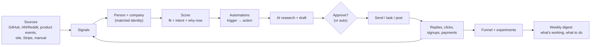
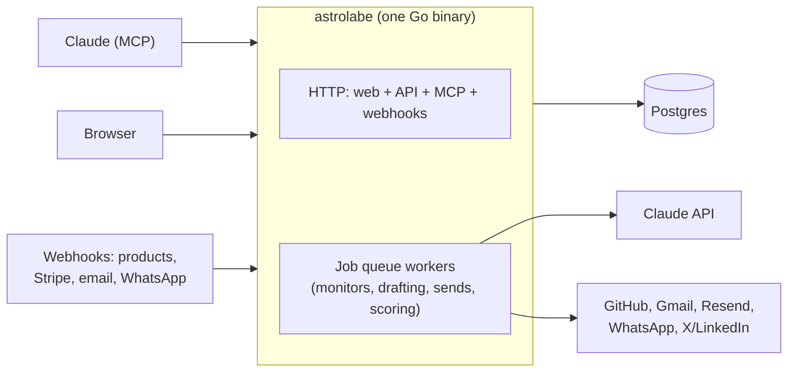

# Astrolabe

**Go-to-market for the everyday programmer.** You built something; Astrolabe helps people find it and pay for it. It watches for people who have the problem your product solves, drafts outreach you approve, follows up, and shows which efforts turn into users and revenue. You drive it from Claude (MCP) or a small web app, and you configure it the way you configure everything else: YAML and Markdown in a git repo.

Updated 24 September 2026.

## 0. Who it's for

Developers who ship products (dev tools, SaaS, apps) and would rather write code than learn five sales tools. You don't need to know what an "ICP" or a "nurture cadence" is: Astrolabe uses developer terms (events, rules, pipelines) and explains the rest in the glossary below. If you (or a teammate) do speak sales, those words work too.

**How it's delivered:** open source under AGPL-3.0 at github.com/AstrolabeGTM/astrolabe, shipped as a Docker image (`ghcr.io/astrolabegtm/astrolabe`) plus Postgres that you self-host, the way people run Mattermost or Penpot. Each developer or team runs their own instance for their own products; there are no shared accounts or multi-tenancy. A hosted version is an open decision (§14).

**Examples in this doc** use two products: *Pipewrench*, a developer tool that finds flaky CI tests (cold outreach to engineers; also the runnable demo), and *Parlo*, a consumer app (messages to existing users). Swap in your own.

**Glossary (what Astrolabe calls it, what sales tools call it, what it means):**

| Term | Meaning |
| --- | --- |
| Signal (intent data, buying signal) | An event about a person: they opened a GitHub issue about your problem, starred your repo, posted on HN, signed up. Stored once per dedupe key, like an idempotent event log. |
| Target (ICP, persona) | Who the product is for, in plain sentences (`target:` in `product.yaml`). |
| Fit rules (firmographics, technographics) | Machine-checkable version of the target: facts like `ci:github-actions` or `lang:typescript` with weights. |
| Score / priority (lead score, MQL) | `0.4·fit + 0.4·intent + 0.2·why_now`, 0–100. Priority A (≥70) means contact now; D means just watch. |
| Intent / why now | Recent signals, decaying with a 10-day half-life / time-sensitive signals in the last 14 days. |
| Sequence (cadence, drip, email campaign, nurture) | A timed list of message steps (`sequences/*.yaml`). `kind: cold` for people who don't know you yet, `kind: users` for existing users. |
| Campaign (ad campaign, flight, insertion order) | A planned push with a goal, landing page, budget cap, dates, gate checklist, launch tasks and creatives (`campaigns/*.yaml`, §15.9). Not the same as a sequence. |
| Automation (play, playbook, workflow) | A rule in `automations.yaml`: *trigger → when → action*, like a CI workflow. "On a `github.issue_pain` signal, if fit ≥ 50, start the `technical-intro` sequence." |
| Funnel / stages (pipeline, lifecycle stages) | Your product's pipeline states (`reached → replied → installed → first_report → paid`). A person's furthest stage is their state. |
| Activation | The stage where a user first gets real value (the "aha" moment). The number to move. |
| Offer | The one concrete thing every message asks for: a promise, a call to action and a URL. |
| Attribution | Which signal, link or automation brought a person in, and what happened after. |
| Do-not-contact (suppression list, DNC) | People nobody will message again, across all your products (unsubscribes, bounces, "no"). |
| Auto-approve (autonomy) | Letting clean AI drafts send without your click: `none`, `follow_ups` or `all`. |

Both vocabularies work everywhere: the MCP tools map sales words to the same actions, and config files accept the sales keys as aliases (`icp`, `autonomy: manual/first_step/auto`, `sender.outbound/lifecycle`, `limits.outbound_per_day`, `kind: outbound/lifecycle`, `plays.yaml`). Giving both forms of one setting is an error.

## 0.1 Getting started, for a developer

The first five minutes need no accounts. `astrolabe init -template demo` writes a workspace (a demo product, JSON schemas, `compose.yaml`, `.env`), and `docker compose up` starts it in **sandbox mode**:
- Every channel delivers to a local **Outbox** (web page and MCP tools) instead of a provider.
- The Outbox can **simulate a reply or bounce** through the real reply-matching code, so sequences stop, replies appear to label, and bounces add people to do-not-contact exactly as they would live.
- The mode is recorded in the database on first start and a different mode is refused later, so test data and real sends never share a database (`astrolabe mode set` switches deliberately). A banner shows on every page, MCP results carry the mode, and demo products (`demo: true`) only load in sandbox.

Then, for a real product:
- **`astrolabe init -template devtool|saas|app`** writes a product folder with starter monitors, automations and sequences. Claims and voice start as `STUB:` files, so nothing is sent until you write them.
- **JSON schemas** for `product.yaml`, `sequences/*.yaml`, `automations.yaml` and `monitors.yaml` are generated from the config structs (`astrolabe schema`). Each YAML file references them, so editors autocomplete keys, explain them on hover and flag typos; the schemas include the sales aliases.
- **`astrolabe doctor`** checks the database, mode, products, a connected mailbox for every sender address, channel secrets, public URL, webhooks and tokens, and prints the exact fix for each problem. `-connect` also tests SMTP/IMAP logins, the GitHub token, the Claude key and SPF/DMARC, without sending anything.
- **Simple email:** connect any mailbox with SMTP/IMAP and an app password (Settings or `astrolabe mailbox add`), with presets for Gmail, Fastmail, iCloud and Zoho. See §7.

## 1. Principles

1. **Capability without machinery.** A full GTM loop (monitoring, scoring, sequences, funnels, experiments) in one Go binary and one Postgres database. Nothing else to run.
2. **Config as code.** Each product is a folder of YAML and Markdown you keep in git, review in PRs and validate in CI (`astrolabe product validate`). Setting up a new product should take an hour, not a week.
3. **Comfortable for developers, fluent in sales.** Tools, pages and config keys are named in terms a programmer already knows, and GTM concepts are explained where they appear. Sales vocabulary still works: ask Claude to "enroll these leads in a cadence" or "show my MQLs" and it maps to the same tools. A founder, a developer or a salesperson can all use it.
4. **Signals drive the work.** Nothing is sent to a list just because the list exists. Every message traces back to something the person did or something that happened.
5. **You approve, then you trust.** Every product starts with every message needing your approval. You turn on `auto_approve` per product once the drafts are consistently good; flagged drafts always wait.
6. **Honest numbers.** Funnel and attribution come from events you can inspect. No vanity scores, no modelled attribution you can't explain.
7. **Integrate the minimum.** Use APIs where they're reliable (GitHub, email, Stripe, webhooks). Where automation gets accounts banned (LinkedIn, X DMs), produce a ready-to-paste task instead.
8. **Conversion before coverage.** Start with one target, one offer and one automation per product. Add a monitor or channel only when it helps a specific bottleneck. Success is people reaching value and paying.

## 2. The loop



The same loop covers every GTM motion:
- **Cold outreach** (Pipewrench): a GitHub issue about a flaky test becomes a task to help in the issue thread itself. People who gave you an address (an import, a form, a reply) get research notes, then an email sequence. GitHub data never starts a cold email (§15.1).
- **Users** (Parlo): a user finishes the placement test but never starts a lesson, so they get a WhatsApp or push nudge toward the first lesson.
- **Content**: a release note becomes launch posts.
- **Community**: a Hacker News thread becomes a task for you to reply in person.

## 3. Products

Each product is a folder `products/<id>/` with `product.yaml` plus a few markdown files. The AI builds the first version by interviewing you in chat, and you edit it from there.

```yaml
id: pipewrench
name: Pipewrench
url: https://pipewrench.example
one_liner: Finds flaky CI tests and tells you why they fail.
audience: b2b                  # b2b (accounts + people) or b2c (users)

target:                         # who it's for, in plain sentences
  include:
    - Teams whose CI is slowed down by flaky tests
    - Handles payment/commerce webhooks (Stripe, Razorpay, Shopify)
    - 5–50 backend engineers
  exclude:
    - Pure frontend teams

funnel:                         # ordered; each stage is an event name
  - reached
  - replied
  - site_visit
  - installed                   # added the GitHub Action
  - first_report                # aha moment: first flaky-test report
  - ci_enabled
  - paid

activation: first_report        # the stage that defines "activated"

offer:
  promise: "Help you test one async workflow and inspect the result"
  cta: "Send one workflow you'd like to test"
  destination: https://pipewrench.example/start
  success_event: first_report
  window: 14d                  # observation window, not a promised result

claims:                         # the only product claims the AI may make
  allowed: claims.md
  never:
    - "guarantees no bugs"
    - "zero false positives"

voice: voice.md                 # tone, examples, words to avoid
sender:
  cold: you@try-pipewrench.example   # cold email, from a separate domain
  users: hello@pipewrench.example

auto_approve:                   # which AI drafts go out without your click: none | follow_ups | all
  cold: none
  users: none
limits:
  cold_per_day: 40
  touches_per_person_per_week: 2

fit:                            # facts come from enrichment, import or chat
  - {any: [ci:github-actions, ci:circleci], weight: 35, label: hosted CI}
  - {any: [lang:typescript], weight: 20, label: TS/Node}
  - {any: [dep:stripe, dep:razorpay], weight: 30, label: payment webhooks}
  - {any: [dep:react-native], exclude: true, label: mobile app repo}
```

Other files in the folder:

| File | Purpose |
| --- | --- |
| `claims.md` | What is true about the product, with proof links. Drafts may only use these. |
| `voice.md` | Tone plus 3–5 example messages you're happy with |
| `objections.md` | Common objections and honest answers, used for reply drafts |
| `monitors.yaml` | Which signal sources are on and their settings (§4) |
| `automations.yaml` | Trigger → action rules (§6) |
| `campaigns/*.yaml` | One file per campaign: goal, landing page, budget cap, dates, stop rule, gate, launch tasks and creatives (§15.9) |

**One concrete offer.** Each product starts with the offer above; an automation may override it. The message, landing page and next step must make the same promise. Use the existing product site or onboarding flow, carrying a automation/link ID through signup where possible. If people click but never reach value, improve that step before finding more people. Astrolabe does not need a landing-page builder.

## 4. Signals

A **monitor** produces signals. Monitors are either scheduled (polling) or event-driven (webhooks). They are built in once and configured per product.

| Monitor | Type | Example signals | Products it suits |
| --- | --- | --- | --- |
| `github_search` | Scheduled, hourly | Issues/PRs mentioning "flaky test", "fails intermittently"; repos adding a test runner | Dev tools |
| `github_repo` | Scheduled | Stars, forks, issues and discussions on your repos or a competitor's (`events: [star, fork, issue, discussion]`) | Dev tools |
| `github_release` | Scheduled, daily is enough | No signals: daily counts of release downloads, stars, forks, watchers, open issues and discussions (section 15.3) | Dev tools with releases |
| `netlify_forms` | Scheduled, hourly | A request or sign-up form on a Netlify site: each verified submission is a person, a signal and optionally an account (section 15.5) | Anything with a static site |
| `form_webhook` | Webhook | The same, for a form on your own server that posts to `/hooks/forms/<product>` (section 15.5) | Anything with a form |
| `community` | Scheduled, hourly | HN, Reddit, Lobsters, Stack Overflow, RSS keyword matches | All |
| `product_events` | Webhook | signup, activated, stalled, limit hit, invited teammate | All (your apps send these) |
| `site` | Product events + tracked links | Pricing or docs visits by a known person: send them as product events (e.g. `type: pricing_visit`); clicks on tracked links arrive as `link.click`. No PostHog integration yet | All |
| `stripe` | Webhook | Trial, upgrade, failed payment, churn | All paid products |
| `inbox` | Webhook | Replies, bounces, unsubscribes | All |
| `manual` | Chat or CSV | "Add these 30 people", a forwarded email | All |

The `discussion` event of `github_repo` reads GitHub Discussions through GraphQL, which needs `ASTROLABE_GITHUB_TOKEN`. Each new discussion (author login, title, URL, category) becomes a `<signal>.discussion` signal for its author, identified by GitHub login like an issue. Without a token that event reports a clear error in the monitor's last run while the monitor's other events still run.

Monitors are configured in `monitors.yaml`:

```yaml
- id: pain-issues
  type: github_search            # github_search | github_repo | community | github_release | netlify_forms | form_webhook
  query: '"flaky test" is:issue language:TypeScript'
  signal: github.issue_pain
  strength: 25
  why_now: false                  # true for time-bound triggers (postmortems, launches)
  every: 1h
- id: community
  type: community
  keywords: ["webhook idempotency"]
  sources: [hn, stackoverflow, rss]   # Reddit needs OAuth; add its RSS feeds under feeds: instead
  feeds: []
  signal: community.thread
  strength: 5
  every: 2h
```

Each run looks back to the previous successful run (a week on the first run), and GitHub searches are date-bounded because search returns at most 1,000 results. One failing source doesn't stop the others; errors show on the Signals page.

Every signal is stored in the same shape:

```json
{
  "product": "pipewrench",
  "type": "github.issue_pain",
  "occurred_at": "2026-09-24T10:12:00Z",
  "subject": {"github": "octo-dev", "email": null, "company_domain": "acme.example"},
  "strength": 25,
  "evidence_url": "https://github.com/acme/api/issues/812",
  "data": {"title": "Checkout test fails intermittently on CI"},
  "dedupe_key": "gh-issue:acme/api#812"
}
```

**Identity matching.** Signals attach to a **person**, and in B2B also to a **company**. Match people through verified links between email, GitHub login and product user ID; product user IDs are scoped to their product. A company domain groups accounts, never merges coworkers into one person. Matches are deterministic only, with no fuzzy merging. If a link is ambiguous it goes to a review list and is never guessed.

**Enrichment**, cheapest first:
1. Public GitHub profile and repo data: the profile's name, `@org` company and public email (recorded as an address found through GitHub, so it does not allow email by itself, §15.1); the signal repo's languages (≥10% of code) and declared dependencies (`package.json`, `requirements.txt`, `go.mod`) become facts like `lang:typescript` and `dep:bullmq`. Facts from an org's repo belong to the company.
2. The company website
3. An optional paid email finder, only for people at priority A or B

## 5. Scoring

Scoring uses simple rules you can read, defined per product:

- **Fit (0–100):** `fit` rules from `product.yaml`, each matching any of a list of facts and adding a weight (the free-text `target` is for people and prompts). An exclude rule makes the person ineligible for acquisition automations, regardless of the combined score.
- **Intent (0–100):** a sum of recent signal strengths that decays over time, with a default half-life of 10 days: `intent = min(100, Σ strength × 0.5^(days/10))`.
- **Why-now (0–100):** a time-bound trigger in the last 14 days, such as a postmortem, funding, a new reliability hire, or a stalled onboarding.

`priority = 0.4·fit + 0.4·intent + 0.2·why_now`

| Priority | Score | What happens |
| --- | --- | --- |
| A | ≥ 70 | Research research + personal outreach. It appears at the top of your inbox. |
| B | 50–69 | Brief + sequence (approval per product auto_approve) |
| C | 30–49 | Watch; newsletter only if subscribed |
| D | < 30 | Watch |

Each score shows its breakdown ("fit 80: hosted CI + TypeScript; intent 45: issue 3d ago, starred repo"). Scores rank eligible prospects; they do not authorize contact. Existing users qualify for users help through product state and channel permission, without needing an acquisition score. Recompute time-dependent scores daily as well as on new signals. Learned models can come later, once there are a few hundred outcomes to learn from.

## 6. Automations: the growth-hacking unit

A **automation** is `trigger → audience filter → action`. It is how one experiment in growth becomes a repeatable machine.

```yaml
# products/pipewrench/automations.yaml
- id: pain-issue-help
  notes: "Audience, offer, max effort — written before starting"
  trigger: {signal: github.issue_pain}
  when: {min_fit: 60, not_contacted_within: 30d}
  action: {task: "Answer in the issue if you can genuinely help", draft: true}
  limit_per_day: 10

- id: postmortem-offer
  trigger: {signal: community.postmortem}
  when: {min_fit: 60}
  delay: 5d                         # never during the incident; rechecked when due
  action: {task: "Offer a free workflow test if they want one"}

- id: stalled-install
  trigger: {stage_stuck: {stage: installed, for: 3d}}
  action: {sequence: first-finding-help}

- id: hn-thread
  trigger: {signal: community.thread}
  action: {task: "Reply personally", draft: true}   # I post it myself
```

```yaml
# products/parlo/automations.yaml
- id: placement-no-lesson
  trigger: {stage_stuck: {stage: placement_done, for: 2d}}
  action: {sequence: first-lesson-nudge}

- id: winback
  trigger: {stage_stuck: {stage: active, for: 21d}}
  action: {sequence: whats-new}
```

Triggers are one of `signal: <type>`, `stage: <entered stage>` or `stage_stuck: {stage, for}`. Filters (`when`) are structured rather than an expression language: `min_fit`, `min_priority`, `min_tier`, `not_contacted_within`, `not_stage`, and `include_excluded` for acquisition automations that should ignore fit exclusions (stage-triggered automations for existing users ignore them by default). Signal automations wait up to 30 minutes for a new person's GitHub enrichment so they aren't judged on missing facts.

Automation **templates** cover the common moves, so a new product starts with a working set:

| Template | What it does |
| --- | --- |
| Signal outreach | A high-intent person gets a personal intro |
| Stalled activation | Someone stuck before the aha moment gets help |
| Trial conversion | A trial user near the end of the trial gets a nudge |
| Win-back | An inactive user gets a "what's new" message |
| Referral ask | A newly activated happy user is asked to refer |
| Launch | A release produces launch posts and a list of targets |
| Community reply | A relevant thread becomes a drafted reply task |

**An automation has an outcome, not just an action.** It inherits the product offer and success event unless overridden. Before starting, record the audience, offer, success event, observation window and maximum effort/spend in the automation file. Start with one small batch you can personally follow through. At review, keep, change or stop it based on activation, payment and what people said; replies and clicks are intermediate signals.

**Prevent competing nudges.** Allow one active conversion sequence per person per product. Before every step, recheck that the person is still eligible and has not reached the goal, replied or started a human conversation. A delayed `stage_stuck` automation must recheck the stall when it runs. Win-back uses time since the last meaningful activity, not time since the first `active` event. A completed purchase or activation cancels obsolete pending messages.

## 7. Outreach and messaging

Email goes only to people who gave you an address. Someone Astrolabe knows only from GitHub is helped in the thread, never emailed (§15.1). An opt-in newsletter to people who asked for it is a separate thing (§15.8).

**Sequences** are ordered steps with delays. Each step targets a channel:

```yaml
# products/pipewrench/sequences/technical-intro.yaml
steps:
  - {channel: email, after: 0d,  brief: true, goal: "offer to test one workflow free"}
  - {channel: email, after: 3d,  goal: "share a relevant replay example"}
  - {channel: linkedin_task, after: 5d, goal: "connect with a short note"}
  - {channel: email, after: 9d,  goal: "polite close-the-loop"}
stop_on: [replied, unsubscribed, bounced, installed]
```

| Channel | How it sends |
| --- | --- |
| `email` (cold) | Any mailbox on a separate sending domain, over SMTP with an app password (the simple setup) or through the Gmail API with OAuth. Replies and bounces come back over IMAP (or the Gmail API) from the same mailbox. |
| `email` (users) | Resend on the product domain when `ASTROLABE_RESEND_API_KEY` is set (with an idempotency key per message), else the Gmail mailbox |
| `whatsapp` | Meta WhatsApp Cloud API with approved templates (Parlo). The step names the template, language and parameters; the draft shows the template as its subject and one parameter per line. Needs `whatsapp.phone_number_id` in `product.yaml` and an explicit WhatsApp opt-in from product events. Replies arrive at `/hooks/whatsapp` (Meta signature); "STOP" unsubscribes |
| `push` / `in_app` | A product webhook: Astrolabe posts a signed `{id, channel, user_id, title, body}` to `notify.url`, and the product's own notification service delivers it (Parlo). `id` is stable per message for dedupe |
| `linkedin_task`, `x_task` | A task in your inbox with the text ready; you send it by hand and mark it done |
| `task` | A to-do in your inbox that is not tied to a network, for example a weekly check-in reminder during a customer evaluation. Nothing is sent; the draft text is the task note, and marking it done completes the step. Allowed in cold and users sequences, with the same rules as the other manual channels. A sequence made only of `task` steps may leave `replied` out of `stop_on`, so a reply does not end the reminders |
| `webhook` | Any product-specific action |

Sequences have a `kind`: `cold` (people who don't know you; counts toward `limits.cold_per_day`) or `users` (existing users; WhatsApp, push, in-app and webhook are users-only, and a channel the user declined in product events is never used). The weekly touch cap covers both.

**Drafting.** When the Claude API is configured, every empty draft is written by a background job; without it, drafts wait for you or for Claude over MCP. The AI writes from:
- the person's research notes and triggering signal
- `claims.md`, `voice.md` and the step's goal

It must cite the signal it references. Drafts are flagged for a never-claim, a leftover placeholder, no reference to the triggering signal, or excessive length. Flagged drafts always wait for you. `auto_approve` per product (`none`, `follow_ups`, `all`, separately for `cold` and `users` sequences) only approves unflagged AI drafts, through the same approval checks as yours. An edit you make while Claude is drafting wins.

**Approvals.** The inbox shows the exact message, the reason ("issue #812, 3 days ago"), and the person's score. From there you can approve, edit, skip or snooze. Edits are saved as examples for the product's voice.

**Automatic stops and classification.** Replies are sorted into interested, question, not now, no, out of office, or unsubscribe. A small fast model suggests the class; at 85% confidence or more it is applied for you, otherwise it is shown as a suggestion:
- Interested replies and questions become drafted answers in your inbox.
- "No" and unsubscribe add the person to do-not-contact.
- Any reply stops the sequence.

**Close the conversation.** An interested reply becomes a task with one next action and a due date: answer a question, help with setup, review a result or send the appropriate purchase link. You handle these before approving new cold outreach. "Not now" can become a reminder for the time they requested; it does not silently restart the sequence. Record a short outcome when closing the task: activated, paid, wrong fit, unclear value, setup blocked, price or later. These reasons tell you what to fix in the offer or product.

**Email over SMTP/IMAP.** A rejection at any SMTP stage (connect, login, MAIL, RCPT, DATA, or the reply to the final ".") means *not sent*. Only a lost answer after the message was fully transmitted is *unknown*. Providers other than Gmail don't file SMTP sends in Sent, so Astrolabe appends a copy there; "Check Sent mail" searches Sent by Message-ID, and says so honestly when a missing copy proves nothing. Replies are polled from the inbox by UIDVALIDITY and last UID, and matched by our Message-ID in `In-Reply-To`/`References`; follow-ups carry the full `References` chain so replies thread in every client. Mailbox credentials live in the secrets volume (mode 0600), never in the database. Microsoft mailboxes are not preset: Microsoft is retiring password SMTP/IMAP.

**Safety rules the code enforces:**
- Each send has one durable row in `actions`, unique on `(enrollment_id, step)`. A worker atomically claims it and rechecks stops, do-not-contact and limits before attempting delivery. Job uniqueness prevents duplicate work records; it does not guarantee exactly-once delivery through an external API. Use the same provider idempotency key where supported. [River's unique jobs](https://riverqueue.com/docs/unique-jobs) are a queue primitive, not a delivery receipt.
- If the provider's result is unknown, the step is marked `unknown` and never re-sent automatically.
- Approval applies to the exact recipient, channel and message shown. Changing any of them requires approval again; stale approved drafts still pass the send-time checks.
- Do-not-contact covers unsubscribes, bounces, "no" replies and a manual list. It applies across all products for the same person, and is checked right before sending.
- Per-product daily limits and per-person weekly touch caps.
- **Pause buttons:** one global pause, one per product and one per sequence. They stop sends at the next check.

## 8. Content and launches

- **Repurpose:** a release note, blog post or changelog becomes drafts for X, LinkedIn, HN, Reddit and a newsletter, each in the product's voice.
- **Launch checklist per product:** HN, Product Hunt, relevant subreddits, newsletters and directories. Each gets a drafted post and is tracked as a task.
- **Campaigns** (§15.9) group posts, launch tasks, creatives and a budget into one plan with a report.
- **Newsletter:** content posted in a period can also be turned into a broadcast to the opt-in updates list (§15.8).
- **Posting stays manual:** each draft can become a task; you post it and mark it posted with the URL (API posting to X/LinkedIn is not built).
- Every public link gets a tracked short link (`<ASTROLABE_PUBLIC_URL>/l/<code>`) with UTM tags and `ref=<code>`, so the funnel can attribute it (§9). Outreach drafts get a per-message link too (`{{.Link}}` in templates; AI drafts have the offer URL swapped for it before approval). A click on a personal link is a `link.click` signal and a `site_visit` stage if the funnel has one; mail-scanner clicks are ignored. A signup event carrying `data.ref` credits its first touch to that link.

## 9. Funnel, attribution and experiments

**Funnel.** Stages come from `product.yaml`. A person enters a stage the first time its event arrives, from:
- outreach events (reached, replied)
- product webhooks (installed, activated)
- Stripe (paid)

The dashboard per product shows:
- people per stage, with conversion and median time between stages, weekly
- where people are stuck, and how many, which feeds the `stage_stuck` automations
- revenue from Stripe, per stage cohort

**Product events** arrive at `POST /hooks/events/<product>`, signed like Stripe webhooks (`Astrolabe-Signature: t=<unix>,v1=<hex HMAC-SHA256 of "t.body">`, 5-minute tolerance) with the secret in `ASTROLABE_EVENTS_SECRET_<PRODUCT>`:

```json
{"id": "evt-123", "type": "installed", "user_id": "u42", "email": "ana@acme.example",
 "occurred_at": "2026-09-24T10:00:00Z", "data": {}, "consent": {"whatsapp": true}}
```

`type` equal to a funnel stage records that stage; every event is also a `product.<type>` activity signal (used for stalls and win-back). Sending `user_id` with `email` links the product account to earlier outreach. `{"events": [...]}` batches work too. Stripe posts to `/hooks/stripe/<product>` with the endpoint's `whsec_` secret in `ASTROLABE_STRIPE_SECRET_<PRODUCT>`: `invoice.paid` and one-off `checkout.session.completed` record payments and `paid`; `charge.refunded` records refunds; trial, failed-payment and cancellation events become signals (and `trial`/`churned` stages if the funnel has them). Pass the product user id as Checkout's `client_reference_id` or `metadata.user_id` to join payments to users. Every webhook is idempotent by provider event id.

**Measure from the first batch.** M1 records the originating automation, contact date, next action and outcome, with manually recorded product outcomes until webhooks arrive. Show eligible people → contacted → replied → activated → paid, with actual counts and a fixed observation window. Recent cohorts still inside that window are labelled incomplete. A signup can arrive without replying; missing earlier events stay unknown rather than being invented. Count each person once per stage and each payment once by its provider event/transaction identity; payment and refund records remain available separately from the first `paid` milestone.

Show direct channel/enrichment/model spend per activated and paying customer, plus estimated operator minutes per automation. With zero conversions, show spend and zero conversions rather than a misleading cost per conversion. These are observed acquisition costs, not proof that the automation caused the purchase.

**Attribution** has three layers:
1. **Source:** the first touch that brought a person in: a monitor, an automation, or a post link/UTM.
2. **Influence:** every automation and sequence that touched them before they advanced.
3. **Matching:** a signup's email, or the product user ID sent back in `product_events`, joins them to earlier outreach.

That's enough to answer questions like "which automation produces paying users", and nothing more elaborate.

**Experiments.** Any sequence step can have `variants` (each overriding subject, body or goal). Assignment is random per person and fixed once made. The experiment report compares how many people reach the next funnel stage, with counts and a simple confidence interval. It flags when there's too little data to call a winner (fewer than 30 sends per variant, or overlapping 95% Wilson intervals).

At low volume, run one offer and read the replies before adding variants. Once volume supports comparison, change one thing at a time and judge it on the preselected success event/window. Use company-level assignment for B2B automations that contact multiple coworkers. A small randomized no-message group can later test whether users nudges add conversions; source attribution alone cannot answer that.

**Weekly digest**, by email (Mondays from 08:00, to `ASTROLABE_DIGEST_TO`), on the Digest page and in chat, per product. Its actions are rule-based from the numbers, not generated prose:
- what moved and which automations and variants are winning
- where people are stuck
- A-tier accounts not yet contacted
- the biggest observed conversion drop and up to three actions for the week, each tied to people or a specific product/offer change

## 10. How you use it

**AI chat (primary).** Astrolabe is an MCP server, so Claude Desktop, Claude Code or Codex CLI is the interface. It speaks two transports with the same tool set ([docs/mcp-tools.md](mcp-tools.md), generated by `astrolabe mcp tools -md`): stdio (`astrolabe mcp`, one process per client, started by the client through `docker compose exec`) and streamable HTTP at `/mcp` on the web port, which needs the running server and a bearer token (`ASTROLABE_MCP_TOKEN`, or one generated into the secrets volume; `astrolabe mcp token [-rotate]` prints or replaces it). Requests without the token get 401; DNS-rebinding and cross-origin browser requests are refused. Setup commands for each client are in the README. Tool names are plain verbs; each description also lists its sales-term equivalents, and the server's instructions map sales jargon to tools, so "enroll these leads in the intro cadence" and "start the intro sequence for these people" both work. Claude answers in whichever vocabulary you use.

| Tools | Example |
| --- | --- |
| `product_setup`, `products`, `product_context` | "Set up a new product called X": Claude interviews you, then writes `products/x/` (claims and voice stay stubs until you agree them) |
| `top_prospects`, `person`, `people`, `signals` | "Who should I contact for Pipewrench this week?", "Tell me about Acme" |
| `add_signal`, `set_facts`, `import_people` | "Bo referred Ana at Acme", "Ana's team uses GitHub Actions", "import this CSV" |
| `ambiguous_matches`, `resolve_match` | "Which signals couldn't be matched to one person?" |
| `monitors`, `run_monitor` | "Run the processed-twice search now" |
| `research` | "Research the top 10 priority-A people" |
| `inbox`, `write_draft`, `ai_draft`, `approve`, `skip`, `resolve_send` | "Show today's drafts", "approve 1–5, rewrite 6 shorter" |
| `label_reply`, `answer_reply` | "Ana is interested; answer that yes, it works with Jest" |
| `start_sequence`, `pause`, `resume`, `do_not_contact` | "Start technical-intro for these 20", "pause all Parlo sends", "never contact bo@x.com" |
| `add_task`, `close_task`, `record_stage` | "Remind me to help Acme tomorrow", "mark them activated; setup took 20 minutes" |
| `automations`, `automation_runs` | "Why did pain-issue-outreach skip people today?" |
| `funnel`, `experiments`, `digest` | "Why did activation drop last week?", "which intro variant wins?" |
| `content`, `content_list`, `content_mark` | "Turn the v0.4 release notes into launch posts" |
| `campaigns`, `campaign`, `set_campaign`, `campaign_history`, `check_gate` | "How is the launch week doing?", "raise the cap to 300 and note why", "tick the landing-page check" |
| `record_spend`, `import_spend`, `campaign_report` | "I spent 25 on LinkedIn today", "import this Reddit CSV", "what did the launch produce?" |
| `creatives`, `render_creative`, `edit_creative`, `approve_creative`, `export_pack`, `make_campaign_tasks`, `campaigns_json` | "Render the social card at both sizes", "approve it", "export the pack", "make the launch tasks" |

Monitors, automations and sequences are files: ask Claude to edit `monitors.yaml` or `automations.yaml`, then reload (Settings, or restart).

**Web app (for speed).** Server-rendered pages. Each explains its terms in one line and points at the file that configures it:
- **Inbox:** sends needing a decision, replies to label (with Claude's suggestion), due to-dos with suggested text and an outcome, then drafts to write and approve (⌘↵ approves, flags shown)
- **Signals:** live event feed filterable by product, type and priority; ambiguous matches; monitor status with "Run now"; add a signal by hand
- **Automations:** each rule's trigger, action and counts, and recent runs with skip reasons
- **People** and a **person page:** import, search, priority with breakdown, facts, research notes, signals, messages; start a sequence; do not contact
- **Funnel:** stages, time between stages, who's stuck, revenue, where people came from and what each automation led to, experiments, cohorts, spend, record a stage by hand
- **Content:** draft posts from release notes, launch to-dos, mark posted with click counts
- **Digest:** the latest weekly summary and a preview
- **Settings:** pause switches, mailboxes, webhook URLs and secrets, product reload

**CLI.** `astrolabe init`, `astrolabe doctor [-connect]`, `astrolabe mailbox add|list|test|remove`, `astrolabe mode [set sandbox|live]`, `astrolabe schema [dir]`, `astrolabe serve` (migrates on start), `astrolabe migrate`, `astrolabe product validate [dir]`, `astrolabe import -product <id> <csv>`, `astrolabe monitor run <product> <monitor>`, `astrolabe score [product]`, `astrolabe gmail auth <address>` (one-time OAuth for a sending mailbox), `astrolabe mcp` (stdio MCP server for Claude and Codex), `astrolabe mcp token [-rotate]` (bearer token for MCP over HTTP), `astrolabe mcp tools [-md]` (list the tools), `astrolabe campaigns export|report`.

## 11. Architecture



| Concern | Choice | Why |
| --- | --- | --- |
| Language | Go | Lightweight; one static binary |
| Database | Postgres | Everything in one place, including the job queue |
| Jobs, schedules, delays | [River](https://riverqueue.com) (Postgres-backed queue) | Durable retries and scheduled jobs without running Temporal or Pub/Sub |
| Web UI | Server-rendered HTML (Go `html/template`, plain forms), embedded in the binary | No frontend build, no code generation; add htmx only where a page needs it |
| DB access | pgx with hand-written SQL; migrations embedded and applied by `astrolabe migrate` | No ORM and no codegen step |
| LLM | Claude API: a stronger model for research notes and drafts, a small fast one for classification | Behind one `llm` package that logs prompt, model, cost and output per call |
| Secrets | Environment variables or GCP Secret Manager | API keys never enter the database |
| Hosting | Start with one small VM running the binary and Postgres; use Cloud SQL when managed backups/recovery justify the cost | One deployment to operate; price the chosen region, disk and backups before committing. Cloud Run is an alternative with the worker configuration below. |
| Infrastructure | Any Docker host with the published image and the `astrolabe init` compose file. `deploy/terraform/` sets up one GCP VM: docker compose with Postgres, Caddy for HTTPS, IAP-only SSH, the env file in Secret Manager, daily `pg_dump` to a versioned bucket; `deploy/deploy.sh` ships your products folder | One deploy story for everyone: the image |
| Local dev | `docker compose up` (Postgres) + `go run ./cmd/astrolabe serve` | |

**Keep deployment boring.** Run the service under a restart supervisor, require operator authentication for web/MCP access, verify incoming webhook signatures, and keep daily database backups off the VM with a tested restore. River workers need CPU even when nobody is using the web app. If using Cloud Run, configure instance-based billing and at least one minimum instance, and handle shutdown/recovery; request-based scale-to-zero hosting does not keep this polling loop running. Budget that always-running capacity plus Cloud SQL separately. See [Cloud Run's background execution guidance](https://docs.cloud.google.com/run/docs/configuring/billing-settings).

**Data model** (every table has `product_id` where relevant):

| Table | Holds |
| --- | --- |
| `products`, `sequences` | Loaded from `products/*/` (config, automations, monitors and claims/voice text), versioned by file hash |
| `companies`, `people`, `identities` | Matched entities with enrichment `facts`; `identities` maps email, GitHub, product user id (`<product>:<id>`), phone, HN, Stack Overflow and Stripe customer to a person, with a `source` saying where each came from (§15.1) |
| `product_people` | Which products a person belongs to, with the first-touch `source` |
| `signals`, `identity_reviews`, `monitor_runs` | Every signal (§4), unique on `(product_id, dedupe_key)`; ambiguous matches; monitor status |
| `scores` | Current fit/intent/why-now/priority with breakdown; recomputed on new signals, enrichment and daily |
| `play_runs` | Each automation run, once per trigger: started a sequence, created a task, or skipped with the reason (internally, automations are "plays") |
| `enrollments` | A person in a sequence (a sequence run): next step, status, stop reason, automation, triggering signal, goal stage; one active per person per product |
| `actions` | Every message, manual task or reply answer: draft → approved → sent/unknown/failed/blocked/skipped; unique `(enrollment_id, step)`; AI state and flags, variant, tracked link |
| `tasks` | Human follow-through: next action, due date, suggested text, outcome and minutes |
| `replies` | Inbound email and WhatsApp messages with classification and suggestion |
| `suppressions`, `channel_permissions`, `pauses` | Do-not-contact (global per person), users consent per channel, pause switches |
| `funnel_events` | Stage entries, deduplicated, with source |
| `payments`, `webhook_events` | Payments and refunds once per provider transaction; processed webhook ids |
| `briefs`, `llm_calls`, `voice_examples` | AI research, every model call with tokens, your edits of AI drafts |
| `links`, `clicks`, `assignments`, `content_items`, `digests` | Tracked links and clicks, experiment assignments, content drafts/posts, weekly digests |
| `mailbox_sync` | Reply polling position per mailbox (Gmail time, IMAP UIDVALIDITY + last UID) |
| `updates_subscribers`, `updates_broadcasts`, `updates_messages` | The opt-in updates list, its broadcasts, and one row per confirmation, welcome or broadcast delivery (§15.8) |
| `settings`, `sandbox_outbox` | Instance settings (the fixed sandbox/live mode); messages "sent" in sandbox mode |

**Package layout:**

```text
astrolabe/
  cmd/astrolabe/            # serve, migrate, product validate, import, monitor run, score, gmail auth, mcp
  internal/
    app/                    # config + wiring (pool, River workers and schedules, channel registry)
    store/                  # pgx pool, embedded migrations, test databases
    product/                # load + validate product folders (plays, monitors, sequences), sync, scaffold
    people/                 # people, companies, identities, import, facts, suppression
    signal/                 # ingest + identity matching, monitors (GitHub, HN, Stack Overflow, RSS), enrichment
    github/                 # small GitHub REST client
    score/                  # fit/intent/why-now scoring and ranking
    play/                   # triggers → filters → actions, rechecks, stage scans
    updates/                # opt-in updates list: double opt-in, unsubscribe, broadcasts, public confirm/unsubscribe endpoints
    outreach/               # enrollments, drafts, approvals, send path, replies, tasks, stages, pauses
    channel/                # sender interface; Resend, WhatsApp, product notify
    gmail/                  # Gmail API: OAuth, send, reply/bounce polling, Sent lookup
    mail/                   # simple email: SMTP send, IMAP replies/bounces/Sent, provider presets
    sandbox/                # sandbox mode: local outbox, simulated replies and bounces
    starter/                # astrolabe init: embedded templates, workspace files
    doctor/                 # setup checks
    draft/                  # briefs, AI drafts and checks, reply classification (uses llm)
    llm/                    # Claude Messages API client that logs every call
    hooks/                  # signed webhooks (product events, Stripe, WhatsApp) and /l/ redirects
    links/                  # tracked short links
    funnel/                 # stage counts and the full report (times, stuck, cohorts, attribution, spend)
    experiment/             # variant assignment and results
    content/                # repurposing and launch tasks
    campaign/               # campaigns: settings with history, gate, spend, creatives, posting tasks, report
    render/                 # optional Chromium sidecar client (Gotenberg 8 over HTTP) for creatives
    digest/                 # weekly digest
    web/                    # html/template pages
    mcp/                    # MCP tools over stdio
  examples/                 # the demo workspace (kept equal to the demo template by a test)
  schemas/                  # JSON schemas for the YAML files (generated, checked by a test)
  Dockerfile, compose.yaml  # image; the demo from source in sandbox mode
  deploy/                   # terraform/ (one VM), deploy.sh, restore.md
  docs/
```

## 12. Build plan

Each milestone is usable on its own.

| # | Milestone | Done when |
| --- | --- | --- |
| M1 | **One offer + manual outreach + outcomes** | One product and offer load and validate. People can be imported. A draft can be approved in the inbox and sent through Gmail, with duplicate jobs blocked and uncertain delivery held for review. Replies stop the sequence. Do-not-contact works. A small real batch has follow-up tasks, manually recorded activation/payment outcomes and a basic funnel. **Status (2026-09-24): code complete; not yet run against a real Gmail mailbox.** |
| M2 | **One useful monitor + scoring (developer tool)** | Start with `github_search`; add `github_repo` or `community` when they produce useful prospects. Identities match. Scores come with breakdowns. The ranked list in chat and the web app is right by your judgment on 20 samples. **Status: built — monitors (GitHub search/repo, HN, Stack Overflow, RSS), enrichment, scoring, Signals page; ranking quality needs your judgment on real data.** |
| M3 | **Automations + sequences + research notes** | `pain-issue-outreach` runs end to end: signal → research → sequence → approval → send → stop on reply. Auto-approve modes work. **Status: built — automations (signal, stage, stuck), rechecks, research notes, AI drafts with flags, auto_approve, reply sorting and drafted answers.** |
| M4 | **Automate measurement + stalled-user help** | Product events and Stripe replace manual outcome entry. Stages, stuck lists, source attribution and revenue show up. `stage_stuck` automations fire and cancel when the person advances. Add a second product once the first loop is useful. **Status: built — signed product-event and Stripe webhooks, payments/refunds, median stage times, stuck lists, weekly cohorts, source and automation attribution, revenue and spend.** |
| M5 | **Users channels (consumer app)** | WhatsApp templates and the product-webhook channel work. A consumer funnel (install → signup → placement → first lesson → active) runs with `placement-no-lesson` and `winback`. **Status: built — WhatsApp templates and replies, product notify channel, Resend users email, channel consent. The Pipewrench demo in `examples/` and the `astrolabe init` templates are runnable versions of these examples.** |
| M6 | **Experiments + content + digest** | Variants and the experiment report. Release → launch posts. Weekly digest. **Status: built — variants with fixed person/company assignment and Wilson intervals, tracked links, content repurposing and launch tasks, weekly digest.** |
| M7 | **Open source, self-hostable, five-minute start** | AGPL-3.0; Docker image and compose; sandbox mode with a local outbox and simulated replies; `astrolabe init` with demo, devtool, saas and app templates; JSON schemas for editor autocomplete; `astrolabe doctor`; SMTP/IMAP email with app passwords; both developer and sales vocabulary in config and MCP. **Status: built; a scripted run from an empty directory to a simulated reply stopping a sequence took under a minute with Docker.** |
| M8 | **Running a real go-to-market** | Section 15: outreach guards, an account pipeline with qualification, form intake, public counters, conversation notes, a reception log, an updates list, campaigns and creative, a weekly review, and a browser app in place of the server-rendered pages. **Status: in progress.** |

After M1, use it with real prospects for your first product and help them reach the activation stage personally. M2 and M3 automate work that proved useful in that batch. These are capability milestones, not a fixed delivery order: move product-event ingestion ahead of more monitors if following existing users to activation is the bottleneck. If people respond but never reach value, fix the offer or onboarding before expanding automation.

## 13. Not doing (until a product needs it)

- Ad-platform automation: no ad-platform APIs, no tracking pixels, no automatic bidding, budget changes or posting. Paid ads management is partly in scope as records, budgets, creative and a report (§15.9): you buy and post by hand, Astrolabe keeps the plan, the money, the approved copy and the counts.
- Automated LinkedIn or X DMs, and posting to X/LinkedIn through their APIs. They stay manual tasks.
- Reddit search: its unauthenticated API is blocked; add subreddit RSS feeds to a `community` monitor instead.
- Paid email finders (enrichment step 3) and company-website enrichment (step 2): only public GitHub data is used today.
- Buying contact lists and bulk cold email. Outreach is signal-led only, and never emails someone known only from GitHub (§15.1).
- Learned scoring models, multi-touch attribution models, BigQuery or dbt.
- Multi-user roles, per-customer installs, Kubernetes, Temporal.

## 14. Open decisions

- **Hosted version.** A hosted, multi-tenant service would be a separate build: accounts, tenant isolation, billing, per-tenant mailbox and webhook secrets. Nothing here is built for it.
- **Pricing**, if there is a hosted or paid tier.
- **Decided:** AGPL-3.0; the public repo is github.com/AstrolabeGTM/astrolabe; distribution is a self-hosted Docker image; email via SMTP/IMAP with app passwords (Gmail OAuth kept as an option).

## 15. M8: running a real go-to-market

Features a solo founder needs once real people start replying, asking for help and talking about the
product. Each is generic; the examples use Pipewrench.

### 15.1 Outreach guards

**Why.** GitHub's [Acceptable Use Policies](https://docs.github.com/en/site-policy/acceptable-use-policies/github-acceptable-use-policies), section 7, forbid using information from GitHub, "whether scraped, collected through our API, or obtained otherwise", for spamming, including sending unsolicited emails to users. A cold email to someone found in a GitHub issue is exactly that, so Astrolabe does not send it unless you turn the guard off.

**Where an address came from.** Every identity records a `source`:

| Source | Meaning |
| --- | --- |
| `github` | Found through GitHub: monitors, profile enrichment, commit or profile emails |
| `event` | Sent by your product's events (a signup form, an app) or a tracked link |
| `stripe` | Came with a Stripe payment |
| `reply` | They wrote to you from this address |
| `import`, `manual` | You vouched for it: a CSV import, or a signal you entered by hand |
| `form` | They typed it into one of your forms (§15.5); counts as an address they gave you |

An address only moves from `github` to another source, and only for the same person: when they give it to you themselves (a signup, a reply, your import). Nothing moves it back.

**The rule.** A person is **GitHub-only** when they have a GitHub login or a GitHub-found address and no email identity from any other source. Unless the product sets `outreach.email_from_github: true`, a GitHub-only person gets no email of any kind: not a cold or users sequence, not an answer to a reply, and not a later broadcast.

```yaml
# products/pipewrench/product.yaml
outreach:
  email_from_github: false   # default. true accepts the policy risk; `astrolabe doctor` warns
links:
  personal: false            # optional: keep the plain offer link, no tracked link per message
```

**Where it is checked.** One function, `outreach.MayEmail(ctx, q, productID, personID)`, answers yes or no with a reason, and every email path asks it:
- *Enrolment.* Starting any sequence with an `email` step for a GitHub-only person is refused, by `start_sequence`, the People page and automations alike, and the reason names the policy. Sequences made only of manual task steps (`linkedin_task`, `x_task`) are still allowed.
- *Drafting and approval.* A step that comes due for someone who has become GitHub-only is held as blocked; approving such a message is refused.
- *Answering a reply.* Refused with the reason. A person who replies from an address has given it to you, so a reply from a GitHub-only person lifts the restriction.
- *The send transaction.* The check runs again. If it fails, the message is held (status `blocked`) with the reason on it and is never sent. This also catches people enrolled before the guard existed.

The reason shows where you see the outcome: the skipped list in the MCP result and People page, the play's run outcome, and the error on a held message in the inbox and outbox.

**What to do instead.** The `devtool` starter turns GitHub issue and repo signals into a task: "answer in the issue if you can genuinely help", with a draft. Help in the thread; if they want to talk further they will give you an address, and the guard opens by itself. If you already know someone's address from them, import it (`import_people`) or add it by hand.

**Personal links.** `links.personal: false` leaves the offer destination as it is: no tracked link is created for each message, and `{{.Link}}` is the plain destination. Clicks are then not attributed to a person.

**Backfill.** Migration 0007 labels existing identities: an address the person wrote from is `reply`; one carried by a signal is `stripe`, `manual` or `event` by the signal's type; people created by import get `import`; anything else on a person with a GitHub login is `github`; the rest are `manual`. The import rule cannot tell a profile email found later from the address you imported, so such a person counts as having given an address.

### 15.2 Account pipeline and qualification

The funnel (§9) follows people. For b2b products, the **pipeline** follows companies (**accounts**; sales: deals, opportunities) through stages you define. Every move needs a short note on what happened, and a qualification gate keeps accounts out of the later stages until the checks are honestly "yes". It is optional: add `pipeline:` to `product.yaml` (it needs `audience: b2b`). The Pipewrench demo has one:

```yaml
pipeline:
  stages: [identified, contacted, qualified, trial, customer]
  qualify:
    gate: qualified
    checks: [pain, champion, timing]   # all must be yes to enter qualified or any later stage
    record: [budget]                   # asked and kept, never blocks
  reasons: [no_fit, no_timing, no_reply, chose_alternative, no_budget, other]   # the default when left out
  stuck_after: 14d                     # the default
```

**An account** is one company in one product's pipeline. It holds:

| Field | Meaning |
| --- | --- |
| Stage, date entered | The current stage, and a history of every stage it entered with the evidence note for each move |
| Next action, due date | Exactly one while the account is open. Setting a new one replaces it, and the database refuses an open account without one |
| Qualification | Each check answered `yes`, `no` or `unknown`, with one line of evidence (required for yes and no) and when it was answered. Unanswered checks count as unknown (sales: BANT, MEDDIC) |
| People | Existing people on the account, each with a role: `champion`, `buyer`, `user`, ... |
| Goal | What the account wants to achieve |
| Timing | What is driving the timing: a release, an audit, a migration (sales: compelling event) |
| Baseline | How they do it today: the existing approach a result will be judged against (sales: status quo) |
| Evidence links | Call notes, documents, issues |
| Paused or lost | A reason from `reasons` and a revisit date, instead of a next action |

**Rules**, enforced in one place so chat, jobs and the browser app behave the same:

- Moving a stage needs a short evidence note (one line).
- Entering the `gate` stage, or any later stage, is refused unless every gating check is yes. The refusal names each failing check and its answer ("cannot enter qualified: ... champion is unknown, timing is no"). This holds for new accounts, moves between later stages and reopened accounts. `record` checks never block.
- `paused` and `lost` are built in, not stages. Either needs a reason from `reasons` and a revisit date. On the revisit date a task appears in the inbox, once. Moving the account to a stage reopens it, with a new next action.
- An open account in one stage for longer than `stuck_after` is **stuck**, except in the last stage, where accounts are meant to stay (an `account_stuck` automation can still name it). A next action due before today is **overdue**.

**Automations.** Two triggers act on accounts, through the same machinery as §6:

```yaml
- id: qualified-trial-plan
  trigger: {account_stage: qualified}            # the account entered the stage (in the last 7 days)
  action: {task: "Send a one-page trial plan with two kickoff dates"}

- id: contacted-no-answer
  trigger: {account_stuck: {stage: contacted, for: 14d}}
  action: {task: "No answer for two weeks: try another person, or pause it with a revisit date"}
```

They run in the hourly automation scan, and right after an account changes through MCP. Each fires **once per stay** in the stage. It stays quiet after the account moves on, and fires again only if the account comes back to the stage later. The task names the account and is linked to it. A `sequence` action starts for the account's champion (or its first person), passes that person's `when` filters, and stops if the account leaves the stage.

**Where you see it:**

| Where | What |
| --- | --- |
| MCP `pipeline` | Open accounts per stage, paused and lost counts, each account's days in stage and next action, stuck accounts, overdue next actions, revisits due |
| MCP `account`, `add_account`, `move_stage`, `qualify`, `set_next_action`, `close_account`, `update_account` | One account in full; add one; move it (refused with the reason at the gate); answer checks; set the next action; pause or lose it; edit goal, timing, baseline, people and links |
| Weekly digest | Accounts per stage, stuck accounts and overdue next actions. Overdue next actions come first in "Do this week", ahead of new outreach |
| Weekly snapshot | Every Monday (or the first hour the server runs that week) one row per account is saved. MCP `pipeline_export` or `astrolabe pipeline export <product> [file.csv]` writes every week as CSV, with a column per check |

In sandbox mode the demo loads five example accounts from `demo-accounts.yaml`, including a stuck one, an overdue next action and a paused account.

Data: `accounts`, `account_stages` (history), `account_checks`, `account_people`, `account_links` and `pipeline_snapshots`; tasks and automation runs carry an `account_id`. Code: `internal/pipeline`, plain Go functions (`Add`, `Move`, `Qualify`, `SetNextAction`, `Close`, `Update`, `SetPerson`, `AddLink`, `Get`, `List`, `BuildBoard`, `Revisit`, `Snapshot`, `WriteCSV`) that the browser app's JSON API can call. The triggers live in `internal/play`.

### 15.3 Public counters

A `github_release` monitor takes one snapshot a day of a repo's public numbers. It produces **no signals and no people**; these are totals about the project, never about a person.

```yaml
- id: releases
  type: github_release
  repo: you/pipewrench          # owner/name
  every: 24h                    # no signal or strength needed
```

Each snapshot records:

- each release asset's `download_count`, by release tag and asset name (draft releases are skipped);
- stars, forks, watchers (`subscribers_count`) and open issues (GitHub counts open pull requests in this number);
- the discussion count, through GraphQL `repository { discussions { totalCount } }`. This needs `ASTROLABE_GITHUB_TOKEN`. Without a token, or if the lookup fails, discussions are skipped and the monitor's last message and the `counters` report say so; the other numbers are still recorded.

Snapshots are stored per day (UTC). Running again the same day replaces that day's value, so reruns never double-count.

**Weekly changes.** The change over the last 7 days is the latest snapshot minus the snapshot 7 days earlier, shown next to the 7 days before that; the report states both windows by date, per asset and in total. If history is shorter than a window, the change is counted from the first snapshot and says so. Where you see it:

- the MCP tool `counters` (sales words: download and star metrics, adoption numbers);
- a short "Public counters" section in the weekly digest, left out when no counter monitor exists.

A download count counts downloads of a release file. It is not installs, users or people: one person can download several times, and CI jobs and mirrors count too. Astrolabe words it that way everywhere.

Code: `internal/counters` (plain Go functions: `Collect`, `Store`, `Weekly`); the `monitor` job calls it from `internal/signal`.

### 15.4 Reception log

The reception log keeps **public mentions** of a product: a Hacker News thread, a Stack Overflow question, a blog post, a GitHub issue. Each has:

| Field | Meaning |
| --- | --- |
| URL | Unique per product; the same page logged twice is stored once (a trailing slash or `#fragment` does not make a new one) |
| date | When it was posted |
| source | `hn`, `stackoverflow`, `rss`, `github`, `manual`, ... |
| title or excerpt | What it says, shortened |
| tone | `positive`, `mixed`, `negative` or `unknown` (the default; set by hand, never guessed) |
| asks a question | True if the title or excerpt contains a question mark |
| found by | `monitor:<id>`, or `manual` |

Two ways in:

- **By hand:** the MCP tool `log_mention`, with `set_tone` to rate it later.
- **From monitors:** add `reception: true` to any `github_search`, `github_repo` or `community` monitor. Its results are also filed as mentions, deduplicated by URL. The monitor still makes its normal signals; a mention is not a person.

```yaml
- id: community
  type: community
  keywords: ["pipewrench"]
  sources: [hn, stackoverflow]
  signal: community.thread
  strength: 5
  every: 3h
  reception: true
```

`reception` (sales words: brand mentions, social listening, sentiment) shows the last 7 days of mentions with the window stated, counts by tone and how many ask a question. The weekly digest has a short section with the same counts. Code: `internal/reception` (`Add`, `SetTone`, `Week`), so a later page can reuse it.

### 15.5 Form intake

A request form (or a sign-up form) on your site becomes people, accounts and signals. Astrolabe usually runs on a laptop with no public address, so it **pulls** submissions from Netlify's API. A form on your own server can **push** to a signed webhook instead. Both end in the same code (`internal/forms`, `Intake.Submit`), so they behave identically.

**A form is a monitor.** Both kinds live in `monitors.yaml`:

```yaml
# products/pipewrench/monitors.yaml
- id: request-demo
  type: netlify_forms            # polls Netlify; needs ASTROLABE_NETLIFY_TOKEN
  site: pipewrench.example       # Netlify site id or name
  form: request-demo             # the form's name (the HTML form's name attribute)
  signal: form.request           # signal type recorded for each submission
  strength: 40
  why_now: true
  every: 1h
  account: true                  # open a pipeline account (needs `pipeline:` in product.yaml)
  respond: 1d                    # how soon to reply; default 1d
  fields:                        # optional: Astrolabe key -> your form's field name
    source: heard_from
    message: what_are_you_building

- id: updates
  type: form_webhook             # receives POST /hooks/forms/pipewrench?form=updates; never polled
  signal: form.updates
  strength: 5
  every: 1h
```

`fields` keys are `email`, `name`, `company`, `domain`, `role`, `source` (the self-reported "how did you hear about us"), `campaign` and `message`. A key you leave out matches common names, ignoring case and punctuation: `email`/`work_email`, `name`/`full_name` (or `first_name` + `last_name`), `company`/`organization`, `domain`/`website`, `role`/`title`, `source`/`how_did_you_hear_about_us`, `campaign`/`utm_campaign`, `message`/`comments`/`details`. Only `email` is needed for a person; without a usable one the submission still becomes a signal.

**Netlify.** The monitor calls [Netlify's API](https://docs.netlify.com/api-and-cli-guides/api-guides/get-started-with-api/#forms) with a personal access token in `ASTROLABE_NETLIFY_TOKEN`: `GET /api/v1/sites/{site}/forms` to find the form by name, then `GET /api/v1/forms/{form_id}/submissions` (paged, 100 at a time) for what is new since the last run, as for other monitors. That endpoint returns **verified** submissions; spam is a separate list (`state=spam`) that Astrolabe never fetches, and an item marked spam is skipped as well. Submissions are keyed by Netlify's id, so re-polling never duplicates. A missing token or an unknown site or form shows as the monitor's last error.

**Webhook.** `POST /hooks/forms/<product>` takes a JSON object of fields, signed exactly like product events (header `Astrolabe-Signature: t=<unix>,v1=<hmac>`, HMAC-SHA256 over `<t>.<body>`, 5-minute tolerance) with the secret `ASTROLABE_FORMS_SECRET_<PRODUCT>` (product id upper-cased, dashes as underscores). The form is the product's `form_webhook` monitor named in `?form=<monitor id>`; the parameter can be left out when the product has only one. A field named `id` makes retries safe; without one a hash of the body does. A bad or missing signature is refused with 401 before anything is stored.

**What a submission does**, once, whichever way it arrived:

1. **Stored** in `form_submissions`, unique by product, monitor, source (`netlify` or `webhook`) and external id, with every field as submitted. The host's `ip` and `user_agent` are dropped.
2. **Person**: found or created by email. The address is recorded with identity source `form`, so the outreach guard (§15.1) treats it as an address they gave you, and a GitHub-only person who then submits a form becomes emailable. Name and role fill blanks only.
3. **Company**: from the `domain` field, else the email's domain (free-mail such as gmail.com and outlook.com is ignored), else the `company` name alone.
4. **Account**: with `account: true` and a pipeline, the company gets an account in the **first stage** with the next action "Reply to the request" due in `respond`. If the company already has an account, the person is added to it and its stage and next action are left alone.
5. **Signal** of the monitor's `signal` type. Its data has every submitted field under the form's own names, plus `campaign` (when present; the keys a campaign attribution reads), `reported_source` and `form`.
6. **Self-reported source**, as written, stored on the person per product (`product_people.reported_source`) and shown by the MCP `person` tool as `reported_source`, beside the first touch. It is never merged into first-touch attribution (`by_source`), because "a friend told me" and "your Hacker News post" are different facts from the first tracked touch.

**The reply task** is not made by the intake. An automation on the signal type makes it, once per signal:

```yaml
- id: form-request-reply
  trigger: {signal: form.request}
  action: {task: "Reply to the request"}
```

The `devtool` template ships this automation and a commented `netlify_forms` monitor; the Pipewrench demo has a `form_webhook` monitor (the demo never polls Netlify), so you can send it a request with a signed `curl` like the README's product-event example. A sign-up form is the same monitor with its own signal type (`form.updates`), and automations or later features react to that type; its person always has the submitted email as a `form` identity and the signal data has every field.

**Reading it.** MCP `form_submissions` lists recent submissions with their person, company, account, self-reported source and campaign; `run_monitor` pulls a Netlify form now; `funnel` has `requests_by_reported_source`: requests since the start of the window by what people said (case-folded), each with its share of the total, plus how many left the question blank.

### 15.6 Conversation notes

After a call, email thread or chat, write down what was said. It takes five minutes, and it is where most of what you learn about the product comes from. A note is about one person and, optionally, their account. It holds:

| Field | Meaning |
| --- | --- |
| Date, channel, duration | When it happened; `call`, `email`, `chat`, `in_person` or `other`; minutes (optional) |
| Assisted | Whether you coached them through using the product. Assisted sessions are counted apart and never as unassisted first use |
| `summary` | What happened |
| `their_words` | Exact quotes. They become marketing copy, so never paraphrase |
| `problem` | The problem, in their terms |
| `current_approach` | What they do today: the baseline a result will be judged against |
| `next_step` | What happens next |

**Optional extras, in the same call** (all or nothing: if any part is refused, nothing is saved):

- **Qualification answers** for the account. They go through the same rules as `qualify` (§15.2), and each answer's evidence line gets the note's date and number added.
- **A new next action with a due date.** It replaces the account's one next action. With no account it becomes a task for the person.
- **The survey answer** (sales: Sean Ellis test): "How would you feel if you could no longer use the product?" `very_disappointed`, `somewhat_disappointed` or `not_disappointed`, plus "what would you use instead?" and "who else would benefit?", word for word. Only people who used the product two weeks or more are asked; you record `used_two_weeks` as given, and answers marked false are listed but left out of the counts.
- **Pricing statements** (sales: willingness to pay, budget): the offer named, what it would replace (the comparison), who would approve it, how they buy (`card`, `invoice` or `procurement`) and their reaction. They are what people said, not commitments.

**Where you see it:**

| Where | What |
| --- | --- |
| MCP `log_conversation` | Writes a note and all of the extras in one call; returns the note and the updated account |
| MCP `conversations` | Notes, newest first, filtered by product, person, account, last N days and assisted (true or false), with assisted and unassisted counts |
| MCP `person`, `account` | Each also lists its notes under `conversations` |
| MCP `pmf_survey` | People per answer, with the total answers, the people behind them and the window. Never a percentage without the counts: read each count against the total |
| MCP `pricing_feedback` | For a window: counts by offer, by comparison and by buying process, with every statement and quote |
| MCP prompt `weekly_themes`, tool `week_notes` | Gathers an ISO week's notes (their words, problems, current approaches, survey answers, pricing reactions) and asks the model to group them into themes with exact quotes and counts. Prompts need client support; `week_notes` returns the same material and instructions as a tool |
| MCP `save_themes`, `themes` | Store and read the week's themes for a product, as text with optional items (theme, count, quotes, note), keyed by product and ISO week such as `2026-W43`. Saving again replaces them. A weekly review page reads them from here |
| Weekly digest | Notes logged in the last 7 days (assisted and unassisted counts), the survey answers so far (a count per answer and the total), and the saved themes of this ISO week, or last week's if this week has none yet |

In sandbox mode the demo loads three example notes from `demo-conversations.yaml`: two with survey answers, one of them an assisted session.

Data: `conversations`, `pmf_answers`, `pricing_feedback` and `weekly_themes`. Code: `internal/notes`, plain Go functions (`Log`, `List`, `Count`, `PMFSurvey`, `PricingFeedback`, `Gather`, `SaveThemes`, `GetThemes`, `DigestSection`, `ISOWeek`, `WeekBounds`) that the browser app can call.

### 15.7 Hand-set facts

Facts do not have to come from a person. A hand-researched account list (company, domain, facts, notes, no people) can be imported on its own, and people are added later.

**Import.** `import_companies` (MCP) or `astrolabe import -companies -product <id> accounts.csv` reads a CSV with a header row:

| Column | Meaning |
| --- | --- |
| `domain` (or `company_domain`, `website`) | Required. A URL is cut down to its host; `www.` is dropped. |
| `company` (or `name`) | Display name. |
| `facts` | `;`-separated lowercase `kind:value`, e.g. `fact:agent_moves_money;fact:sells_to_enterprise`. |
| `notes` | Free text, stored on the company. |

Other columns are ignored. Companies are matched by domain, so importing the same file again is safe: blank names and notes are filled but never overwritten, facts merge with the source label `import`, and a fact that is already there keeps its original source (a fact you set by hand stays `manual`). A row with a bad domain or a fact without a colon is skipped and reported; the rest still import. The result lists each company with its facts, `new_facts` (0 on a re-import) and its fit.

**Add facts by hand.** `set_company_facts` takes a company (id or domain) and `kind:value` facts, source `manual`, and rescores. Pass `product` to see the company's fit straight away.

**Company fit.** `score.CompanyFit(product, facts)` scores a company's own facts against the product's `fit` rules and returns the points, a breakdown in the same `label +weight` style as a person's fit, and whether an `exclude` rule matched. Person scoring uses the same function over the person's facts merged on top of the company's, so every person at a company gets its facts in their fit.

**Products.** The schema has no link between a product and a company (only people are registered to a product), so imported companies are not tied to one. `import_companies` takes a product only to compute fit. The account pipeline will link companies to products.

**Python dependencies.** GitHub enrichment also reads `pyproject.toml` (`[project] dependencies` and `[tool.poetry.dependencies]`) and `requirements.txt` into `dep:` facts, with names lowercased and `_` written as `-`. `requirements.txt` still also writes the older `pip:` facts.

### 15.8 Updates list

**Why.** Some people don't want a conversation, only to hear when something ships. An updates list (sales words: newsletter, mailing list, nurture list) is for them: people who asked, and confirmed, to get an email now and then. It is separate from sequences: nothing here is outreach, and nobody is added by Astrolabe finding them.

**Config.** An `updates:` section in `product.yaml` turns it on:

```yaml
# products/pipewrench/product.yaml
updates:
  name: Pipewrench updates        # default "<product> updates"
  from: hello@pipewrench.example  # default sender.users
  via: smtp                       # smtp (the From mailbox) or resend
  per_day: 100                    # broadcasts sent in any 24 hours; default 100
  postal_address: "Pipewrench Ltd, 1 Example Street, Exampleville"   # required before any broadcast is sent
  confirm_within: 7d              # an unconfirmed sign-up expires; default 7d
  # confirm_subject, confirm_body, welcome_subject, welcome_body: your own words;
  # templates may use {{.List}}, {{.Product}}, {{.Email}}, {{.Expires}}
```

| Key | Default | Meaning |
| --- | --- | --- |
| `name` | `<product> updates` | List name, shown to subscribers |
| `from` | `sender.users` | Sender. Replies to it confirm and unsubscribe, so for `via: smtp` it must be a mailbox Astrolabe reads (`astrolabe mailbox add`) |
| `via` | `smtp` | `smtp` sends from the mailbox; `resend` uses `ASTROLABE_RESEND_API_KEY` |
| `per_day` | 100 | Daily cap for broadcasts, so a personal mailbox is not flooded. Confirmations and welcomes are not counted |
| `postal_address` | none | In every message. Commercial email law (CAN-SPAM and others) requires one; approval and sending refuse without it |
| `confirm_within` | `7d` | How long a sign-up can wait for confirmation |
| `confirm_*`, `welcome_*` | short plain texts | Subject and body. How to confirm and how to unsubscribe are added by Astrolabe and cannot be edited out |

**Sign-up is double opt-in.** A sign-up is a *pending* row and nobody receives a broadcast until they confirm. Ways to start one:
- *Automation* `action: {updates: subscribe}`, for example on `signal: form.updates`. It subscribes that signal's person, using the email they submitted (an identity with source `form`; the form-intake feature, §15.5, produces such signals). It skips fit, tier and open-to-do filters (they asked) but not do-not-contact, and an automation that follows an account trigger is refused at load time because it has no person. Outcome `subscribed` (a confirmation was queued) or `skipped: <reason>` in `automation_runs`.
- *By hand:* `updates_add` (MCP), for someone who asked in person. It finds or creates the person by email and sends the same confirmation.

**Confirming works without a public address.** Astrolabe usually runs on a laptop with no URL, so the mechanism is a reply:
1. The confirmation email says *reply to this email to confirm*. The reply is read by the same IMAP polling as any reply and matched by our Message-ID in `In-Reply-To`/`References`; any answer confirms unless it starts with *no*, *stop*, *unsubscribe*, *cancel* or *remove*.
2. It does not confirm if it comes from a different address, is an auto-reply (`Auto-Submitted`, out-of-office subjects; the confirmation itself is marked `Auto-Submitted: auto-generated`), or arrives after the request expired.
3. With `ASTROLABE_PUBLIC_URL` set, the email also has a link `/updates/confirm/<token>`. The token is an HMAC of the subscriber id with a random key kept in `settings`, so it is unguessable, and a confirm token cannot unsubscribe. A GET shows one button (mail scanners open every link); the POST confirms.

An unconfirmed sign-up expires after `confirm_within` (status `expired`; an unsent confirmation is dropped). They may ask again later, which needs a new confirmation. Confirming queues one welcome email. The sandbox demo seeds exactly this: two people confirmed by a simulated reply, one waiting, and a draft broadcast.

**Unsubscribe is honoured before the next send.** Every message has:
- `List-Unsubscribe: <mailto:FROM?subject=unsubscribe …token>` (works with no public URL; a mail client sends a new message whose subject carries a signed token, which the IMAP polling reads), plus, with a public URL, `<https://…/updates/unsubscribe/<token>>` and `List-Unsubscribe-Post: List-Unsubscribe=One-Click` (RFC 8058: the mailbox provider POSTs it);
- a visible line in the body: reply "unsubscribe", or open the link.

A reply to any list message saying *unsubscribe* or *stop* also leaves the list. Unsubscribing drops anything queued for that person in the same transaction, and the send transaction rechecks the subscriber's status, so a message already queued is skipped (`skipped: not subscribed`).

**Unsubscribe is not do-not-contact.** Leaving the list means "no more newsletters", not "never contact me", and the same person may be a user you rightly help or a conversation in progress. So unsubscribing touches only the list. They go on the global do-not-contact list only if they ask for everything: a reply of exactly *stop all* or *unsubscribe all*, or a STOP/UNSUBSCRIBE reply to outreach (existing semantics, §7). In the other direction, anyone already on do-not-contact is never added or mailed. A bounce marks the address `bounced` and stops sends to it.

**Broadcasts.** A broadcast is one email to the confirmed list:
1. *Draft.* `broadcast_create` takes a subject and text, or a `period` (`this-month`, `last-month`, `YYYY-MM`, `30d`) and builds the text from the content items marked posted in that period (§8; if any are `newsletter` items, only those). Nothing calls the Claude API.
2. *Edit.* `broadcast_edit`. Flags are recomputed with the claims check from `internal/draft` (a never-claim, a leftover placeholder; length is ignored because a newsletter is long).
3. *Approve.* `broadcast_approve` approves the exact sender, list name, postal address, subject and body (a hash). Copy with flags is refused until fixed, and so is a product without `postal_address`. There is no auto-approve for broadcasts. Approval queues one row per subscriber confirmed *at that moment*; later joiners get the next one. Editing withdraws the approval and removes what was queued; once any message has been claimed the broadcast can only be cancelled (`broadcast_cancel`).
4. *Send.* Under the same advisory lock as outreach, one transaction per message rechecks: broadcast still approved and unchanged (including the postal address), subscriber still confirmed, not on do-not-contact, `outreach.MayEmail` (the GitHub-only guard, §15.1, reused rather than copied), no pause, `postal_address` set, and fewer than `per_day` broadcasts claimed in the last 24 hours. Then it marks the row `sending`, calls the provider, and records `sent`, `failed` (certainly not sent: tried again up to 3 times) or `unknown` (the answer was lost: never resent; check the mailbox). A row left `sending` for 10 minutes becomes `unknown`. `UNIQUE (broadcast_id, subscriber_id)` is the final guard: nobody receives a broadcast twice, across restarts and concurrent workers.

The footer is added at send time: why they get it, the unsubscribe line, and the postal address. Sandbox mode sends everything to the local outbox, so `simulate_reply` can confirm or unsubscribe a simulated person through the real reply handling.

**Tools** (`docs/mcp-tools.md`): `updates_subscribers` (counts: pending, confirmed, unsubscribed, expired, bounced, and the list), `updates_add`, `updates_unsubscribe`, `broadcast_create`, `broadcast_edit`, `broadcast_approve`, `broadcast_cancel`, `broadcast_status` (state, sent/queued/unknown/failed/skipped, and what is holding it), `updates_export` (confirmed subscribers as CSV; cells that start like a formula are quoted).

**Digest.** Each product with a list gets a line: confirmed subscribers, new this week, unsubscribed this week, waiting to confirm, and the status of recent broadcasts.

**Tables** (migration 0012): `updates_subscribers` (one per person per product: status `pending`, `confirmed`, `unsubscribed`, `expired`, `bounced`; source, how it was confirmed), `updates_broadcasts` (text, status `draft`/`approved`/`cancelled`, approval hash, content items used), `updates_messages` (every confirmation, welcome and broadcast delivery; status `queued`, `sending`, `sent`, `failed`, `unknown`, `skipped`). Replies that confirm or leave a list are labelled `list` or `unsubscribe` and never reach the outreach matcher. Code: `internal/updates` (`Service`: `AddByEmail`, `SubscribeTx`, `Confirm`, `Unsubscribe`, `CreateBroadcast`, `EditBroadcast`, `ApproveBroadcast`, `Process`, `HandleInbound`, `Routes`, `WeekSummary`), so any page can reuse it.

**Limits.** With `via: resend` and no public URL, nobody can confirm or unsubscribe by reply, because Resend does not deliver replies to Astrolabe; `astrolabe doctor` warns. Opening links and bounces from providers other than the polled mailbox are not seen. There is no resolve step for `unknown` list messages yet; look in the Sent folder.

### 15.9 Campaigns and creative

A campaign is a planned push with a goal, a landing page, a budget cap and work to do: a launch week (organic posts and launch tasks), or a small paid test (a boosted post, a newsletter sponsorship, search ads). Astrolabe keeps the plan, the money, the approved copy and the counts. You buy and post by hand: nothing is ever posted automatically, there is no ad-platform API and no tracking pixel. Sales words: ad campaign, flight, insertion order, creative review. The MCP tools list them.

**The file.** `products/<id>/campaigns/<id>.yaml` (JSON schema `schemas/campaign.schema.json`; a product without the folder is fine). It gives the defaults:

```yaml
# products/pipewrench/campaigns/launch-week.yaml
code: launch                     # short code for landing-page variants and attribution
label: Launch week
goal: "Tell teams with flaky CI that Pipewrench exists, and get them to try it on one repo."
audience: "Engineers whose CI is slowed down by flaky tests."
channels: [hn, x, newsletter]
offer: "Run Pipewrench on one repo and see the three flakiest tests."
landing: https://pipewrench.example/c/launch
success_event: signed_up         # a funnel stage, or a signal type such as form.request
budget: {cap: 150, currency: USD}  # 0 means nothing is planned to be spent
start: "2026-11-02"
end: "2026-11-09"                # optional
stop_rule:
  text: "Stop paid spend when half the budget has produced no signups."
  when: {spend_pct: 50, max_events: 0}   # optional, checkable
gate:                            # checks before any spend
  - "Landing page is live and says what Pipewrench does"
  - "Every claim in the copy is in claims.md"
tasks:                           # launch tasks; {{link}} becomes the campaign link
  - {id: show-hn, title: "Post Show HN", channel: hn, day: 0, body: "Show HN: Pipewrench finds flaky CI tests. {{link}}"}
creatives:
  - id: social-card
    template: creative/card.html     # HTML with {{field}} placeholders, in the product folder
    sizes: [1200x630, 1080x1080]
    formats: [png]                   # png (default) and/or pdf
    copy: {headline: "Find your flakiest tests", detail: "...", cta: "Try it on one repo", url: "pipewrench.example/c/launch"}
    alt: "A dark card that reads: Find your flakiest tests."
    source: ""                       # where numbers in the copy come from, if it has any
```

Money is written as a number (`200` or `200.50`) and kept in minor units, with no floating point. A currency is not converted: spend must be in the campaign's currency, and the currency cannot change once spend is recorded. The demo template has a small campaign like this one.

**Runtime settings and history.** Budget cap, currency, dates, stop rule and gate checks are changed by the operator while the campaign runs (`set_campaign`, `check_gate`; the browser app later), and the YAML only gives the defaults. A runtime value overrides the YAML value; a field never set follows the YAML. Every change is kept in `campaign_history`: field, old value, new value, who (`mcp`, later `web`), when and an optional note. Setting a value to what it already is records nothing. `campaign_history` shows it. Astrolabe never raises or lowers a budget itself.

**The gate.** A checklist of things to check before spending. It blocks nothing: spend recorded while the gate is not fully checked is allowed but flagged on that entry (`before_gate`), and that flag is a fact about the moment it was recorded, so checking the gate afterwards does not erase it. The report and digest warn about it. A campaign with no gate items has a complete gate.

**Spend.** `record_spend` takes a date, amount, platform and note, and optionally the platform's clicks and impressions. `import_spend` reads a platform's CSV (header row with `date` or `day`, `spend`, `cost` or `amount`, and optionally `clicks`, `impressions` and `platform`; amounts may carry a currency symbol; dates are `YYYY-MM-DD` or like `Dec 3, 2026`, never `02/03/2026`). Rows for the same platform and day are added together, and importing the same file again replaces those days rather than adding to them; unreadable rows are skipped and listed. Warnings come back with every spend and show in the report and digest:
- near the cap at 80% of it, and over it (a cap of 0 means any spend is over); nothing is stopped
- spend recorded before the gate was complete, and the gate still open with money spent
- spend dated outside the campaign dates
- the stop rule met: the checkable form (`when`) is spend at `spend_pct` of the cap with at most `max_events` success events; Astrolabe only warns

**Creative.** A creative is an HTML template plus copy fields, rendered at each size to PNG (and PDF where asked). The template is a file in the product folder; `{{name}}` placeholders take the copy fields (HTML-escaped), `{{alt}}` the alt text, and `{{width}}` and `{{height}}` the size, so one template serves every size. CSS and images beside the template are sent with it, by file name.
- **Renderer.** An optional headless-Chromium sidecar, [Gotenberg](https://gotenberg.dev) 8 (`gotenberg/gotenberg:8`), called over HTTP: `POST /forms/chromium/screenshot/html` with the viewport (`width`, `height`, `format=png`, `clip=true`, which makes the image exactly that size) for PNG, and `/forms/chromium/convert/html` with `preferCssPageSize` for PDF. Astrolabe pins the page to the viewport (one page, no margin). No image library is in the Astrolabe binary and there is no new Go dependency. The image is large (about 1.7 GB), which is why it is off by default.
- **Turning it on.** The sidecar is in `compose.yaml` and the `init` compose file behind a profile and publishes no port: `docker compose --profile creative up -d`. Set `ASTROLABE_RENDER_URL=http://gotenberg:3000` (the compose files default to that). Without a renderer, creatives still work (copy, flags, approval), and `render_creative` says plainly what to start.
- **The copy check** runs on the creative's copy and alt text and on a campaign's posts, exactly as on email drafts (`draft.Check`: never-claims, leftover placeholders, length), plus numbers without a source: a number counts as sourced if it is in `claims.md` or in the creative's `source` text (numbers inside URLs are ignored). Flagged copy cannot be approved, exported or made into a task; it waits for a fix.
- **Approval** covers the exact copy, the template with its files, and every rendered file, by hash. Any edit (`edit_creative`: a copy field or the alt text) withdraws the approval and deletes the rendered files, which no longer show the copy. Rendering again also withdraws it, since the new files are not the ones that were approved. A template or asset that changes on disk voids the approval too, because the hash no longer matches. Approval is allowed with no rendered files at all (the copy alone) but not with only some sizes rendered.
- **Export.** `export_pack` writes an approved pack to a folder (default `exports/<campaign>` in the product folder): each creative's rendered files and alt text, `copy.md` with the copy and the posts, `landing.txt`, and a `manifest.json` with the hashes. It uses the stored approved bytes and never renders again, and refuses while any creative is unapproved or any post is flagged. You post by hand.

**Posting tasks.** `make_campaign_tasks` turns the `tasks` into content items and tasks in the existing launch machinery (§8): due on the start date plus `day`, with the post text as the task's draft. With `ASTROLABE_PUBLIC_URL` set, `{{link}}` is a tracked short link for the campaign (`utm_campaign=<code>`); otherwise it is the landing page. Mark one posted with `content_mark` and its URL, which closes the task. Running it again adds only missing tasks.

**Report.** `campaign_report` (and `astrolabe campaigns report <product> <campaign>`) covers the campaign window, from the start date to the end date, or to today if it is open-ended or not over yet, and says which. It shows:
- spend against the cap, with the number of entries
- the platform's clicks as entered, and on how many spend entries they were entered
- success events attributed to the campaign, out of the platform clicks entered
- clicks on the campaign's tracked short links, signals carrying the campaign code, posting tasks posted out of made, gate items checked out of all
- warnings, and what is not measured: downloads per campaign, anyone who visited and did nothing (no pixel), impressions you did not enter, and successes that did not carry the code

Zero shows as zero. There are counts with what they are out of, and no rates. Cost per success event appears only when there is at least one event, with the spend and the count it came from. These are counts of events that carried the code, not proof that the campaign caused them.

**Attribution contract.** A success event is attributed to a campaign when it carries `campaign=<code>` in one of two places, checked in one function (`campaign.CountEvents`) so other features can plug in:
- a **signal** whose `data.campaign` is the code and whose type is the success event or `product.<success event>` (product events become `product.<type>` signals carrying their `data`, so `{"type": "signed_up", "data": {"campaign": "launch"}}` counts)
- a **funnel event** of the success stage whose `source` is `campaign:<code>`

A person counts once however many of these they have. A later form-intake feature credits a form submission by setting `campaign` in its signal data. Make the landing page pass the code along (for example a hidden form field, or the code in the product's signup call).

**`campaigns.json`.** `campaigns_json` (MCP) and `astrolabe campaigns export [-product id] [-o file]` give a website the landing-page variants of campaigns that have not ended (so a page exists before the first day), using the runtime end date:

```json
[{"code": "launch", "label": "Launch week"}]
```

Each entry is exactly `code` and `label`. Codes must be unique across the products exported together.

**Digest.** Each running campaign shows its spend against the cap, gate status and warnings.

**Tables** (migration 0014): `campaign_settings` (nullable overrides of the YAML), `campaign_history`, `campaign_gate`, `campaign_spend` (with the gate state at the time), `creatives` (copy edits, version, approval hash) and `creative_renders` (the rendered bytes), plus `campaign_id` and `campaign_task` on `content_items`. Code: `internal/campaign` (plain functions, reusable by the browser app), `internal/render`, tools in `internal/mcp/campaigns.go`.

### 15.10 Weekly review

One page of numbers that answers the Friday questions (sales: pipeline review, forecast call, QBR-lite). `review.Build` assembles it for an ISO week from the summaries the digest already uses; nothing is computed twice. Every figure is a count with its denominator and window, and there are no bare percentages. The week is Monday to Sunday (UTC); in the current week the window says `partial` and covers the days so far.

| Section | What it holds |
| --- | --- |
| **Spread** | Public counters' change over the 7 days to the end of the window against the 7 before (§15.3). The updates list's size and week changes (§15.8). Mentions by tone with how many ask a question (§15.4). Form requests this week by the source people reported, with the total and how many left it blank (§15.5, §9). New signals this week by type. |
| **Users** | People entering each funnel stage this week (and the week before). A fixed four-week cohort: people whose first event fell in the four weeks ending with this one, and for each stage how many reached it of how many reached the one before. The funnel's weekly cohorts for the same weeks. The PMF survey counts so far (§15.6). Activation this week split into assisted and unassisted: a person counts as assisted when a note marks a session with them as assisted; the week's notes are counted apart beside it. |
| **Accounts** (products with a pipeline) | Accounts entering each stage this week, including paused and lost. Median days in each stage, with the number of visits behind it. The board's stuck accounts and overdue next actions (§15.2). Paused and lost reasons, counted, for this week and for now. Advocates: people with the `advocate` role on an account. |
| **Response times** | Inbound items that arrived this week: form requests, replies labelled `interested` or `question`, and new GitHub issues and discussions. For each, the time from arrival to the first response: a message sent to that person, or the related task closed (the task made from that reply, or a task for that person or their account created after the item arrived). Per kind: total, answered, **within** target, **over** target (answered late, or still unanswered past the target) and **waiting** (unanswered, still inside the target); the three add up to the total. The five slowest items follow. Clocks are wall-clock hours, nights and weekends included. |
| **Themes** | The week's saved themes (§15.6) and the pricing-feedback summary for its days. |
| **Campaigns** | Running campaigns' summaries (§15.9). |
| **Experiments** | Each experiment on a step that still has variants, with its current verdict (§9). |
| **Questions** | The review's questions, each with its saved answer. |

Trimmed shape of the JSON:

```json
{
  "product": "pipewrench-demo", "week": "2026-W43", "review_day": "friday",
  "window": {"from": "2026-10-19", "to": "2026-10-23", "partial": true},
  "spread": {"requests_by_reported_source": {"total": 3, "unanswered": 1, "sources": [{"source": "hn", "requests": 2, "percent_of_total": 66}]},
             "mentions": {"total": 3, "by_tone": {"positive": 1, "negative": 1, "mixed": 0, "unknown": 1}},
             "new_signals": {"total": 5, "by_type": [{"name": "github.repo.issue", "count": 1}]}},
  "users": {"stages": [{"stage": "activated", "entered_this_week": 2, "entered_previous_week": 0, "activation": true}],
            "four_week_cohort": {"people": 4, "stages": [{"stage": "activated", "reached": 2, "of_previous_stage": 3, "percent_of_previous": 66}]},
            "activation": {"activated_this_week": 2, "assisted": 1, "unassisted": 1}},
  "accounts": {"open_accounts": 2, "median_days_in_stage": [{"stage": "identified", "median_days": 2, "visits": 3}],
               "paused_and_lost_this_week": [{"status": "lost", "reason": "no_budget", "accounts": 1}]},
  "response_times": {"by_kind": [{"kind": "request", "target": "2h", "total": 3, "answered": 2, "within_target": 1, "over_target": 2, "waiting_inside_target": 0}],
                     "slowest": [{"kind": "issue", "label": "...", "hours": 58, "status": "over"}]},
  "questions": [{"number": 1, "question": "How many reached activation, and what did they say?", "answered": false}]
}
```

**Config.** An optional `review:` section in `product.yaml`: `questions` (a list of strings; default the five below), `targets` (`requests` and `replies` default `2h`; `issues` and `discussions` default `24h`; durations like `90m`, `2h`, `1d`) and `weekday` (default `friday`). The default questions: how many reached activation and what did they say; what changed in reach and where did new people say they came from; how many accounts moved and where are they stuck; what did people say that surprised us; what is the single biggest blocker to the next activation. Validation refuses empty or repeated questions, more than 12, a bad weekday and non-positive targets. Code: `product.Review`, `Product.ReviewSettings()`.

**Saving.** `review.Save` stores the operator's answers (by question number or exact text; an empty answer clears one), one decision per running experiment and campaign (`keep`, `change` or `stop`, with a note; the target must be running in that review), and a frozen JSON snapshot of the review as built at the **first** save. Later saves merge answers and decisions into what is there and leave the snapshot alone, so a saved week reloads unchanged however much data arrives afterwards; `refresh_snapshot` rebuilds it on purpose. Answers are kept with the question text they answered, so editing the questions in `product.yaml` does not lose them.

**Tools and prompt** (`docs/mcp-tools.md`): `weekly_review` (this week or a given week; a saved week returns the frozen snapshot with its answers and decisions, plus a fresh build with `fresh: true`), `save_review`, `reviews` (past weeks) and the MCP prompt `friday_review`, which walks the operator through the numbers, the questions and the keep, change or stop decisions, then calls `save_review`.

**Digest.** Each product gets one line: whether this week's review is saved and how many questions are unanswered.

**Table** (migration 0018): `weekly_reviews`, keyed by product and ISO week: `answers`, `decisions`, `snapshot`, `created_at`, `saved_at`. Code: `internal/review` (`Build`, `BuildAt`, `Save`, `Get`, `List`, `WeekStatus`), plain functions the browser app can call.

**Limits.** The stuck and overdue lists and the stage median are read from the pipeline as it is now, so for a week already past, an unsaved review shows today's board; a saved one shows the board as it was. The counters, mentions and updates figures cover the 7 days up to the end of the window, as their own reports do. Replies are matched to a response by the person and by the task made from the reply; a reply answered from outside Astrolabe is not seen. A request with no person (no email in the form) can only be answered by a task for its account.

### 15.11 The browser app

_In progress._

### 15.12 Forgetting a person

An operator who tells people "write to us and we delete your submission and any notes we made about you" needs one command that does it. `astrolabe forget <email|id> [-yes]` and the MCP tool `forget_person` (sales terms: GDPR erasure, right to be forgotten, data deletion request) erase one person, by email address or person id, and report what went. Code: `internal/forget`; the tombstone is in `internal/people/forgotten.go`.

**Dry run first.** The CLI shows the counts and asks; with `-yes` it just erases. The tool without `confirm: true` deletes nothing and returns the same counts (the dry run is the real erase inside a transaction that is rolled back, so the counts are exact). Erasing cannot be undone.

**What is deleted, in one transaction.** The person, their identities (every address, GitHub login, phone, product user id, Stripe id) and product memberships; signals about them, including signals that only name their address and identity reviews that list them; scores and research notes (with the logged LLM call behind a note, and any logged call whose text contains their address, login or full name); enrollments, every draft and sent message to them, replies from them (also from a second address of theirs), sandbox outbox rows and draft-edit examples; tasks about them; conversation notes with their survey answer and pricing statements; account memberships (the account and company stay); form submissions; list subscriptions and list messages; funnel events, tracked links and their clicks, A/B assignments, channel permissions, do-not-contact entries and payment rows; and queued background jobs that name them. The table-by-table counts are in the answer.

**What is kept, scrubbed.** Two things stay because a limit counts them, with every personal field removed. A cold message sent to them in the last 24 hours leaves one anonymous `erased_sends` row (product, which cap, when), so erasing it cannot free room under `limits.cold_per_day`; the same for a broadcast under `updates.per_day`. Rows are pruned after two days. An automation run inside the 24 hours of a play's `limit_per_day` stays with person, signal, enrollment and detail cleared. Free text elsewhere that contains their address, GitHub login or full name (an account's evidence or next action, a company note, a conversation note about someone else, a weekly digest, and any string inside a saved weekly review's snapshot, answers and decisions) is overwritten with `[removed on request]`; the account and company stay. Weekly themes cannot be matched (quotes carry no names), so the answer lists the saved themes written from weeks with their conversations for you to read.

**The tombstone.** Their identities are stored in `forgotten` as `sha256(salt, kind + ":" + value)`, so the table can say "this exact value was erased" but not what it was. The salt is random, per install, in the `settings` table (`forget_salt`): it travels with the database in a backup or move, so tombstones keep working after a restore, which a salt in the secrets volume could not promise. Anyone who can read the whole database can test a guessed address against it; the table adds nothing to what they could already read. All identity kinds are covered, not only email and GitHub. After that, the same address or login is dropped, not created, and never contacted, from every door: a monitor or product event or payment webhook (the signal is not stored), a form or webhook submission, a CSV import (the row is skipped), a reply or bounce naming the address (not stored), and the operator adding them to the updates list (refused). `people.LinkIdentity`, the single path for identities, returns `ErrForgotten` as a last guard. If they submit a form again, intake still drops it and opens one task, "A forgotten person wrote again via the <form> form (<source> submission <id>); decide whether to accept"; it holds no personal data, and the id is how to delete that new submission at Netlify. To accept them again, delete their rows from `forgotten` by hand (there is no tool for it on purpose).

**Netlify.** Before the local erase, each of their `netlify` submissions is deleted at Netlify with `DELETE /api/v1/submissions/{submission_id}` (`deleteSubmission` in Netlify's OpenAPI; 204 on success, a submission Netlify no longer has counts as gone), using the existing `ASTROLABE_NETLIFY_TOKEN`. Webhook submissions have no remote copy. If the token is missing or a call fails, the local erase still finishes and the answer lists the submission ids, form and error under "STILL AT THE SOURCE", for you to delete by hand in Netlify; the CLI exits with an error in that case.

**What Astrolabe cannot reach.** Mail in your own mailbox, database backups taken earlier, and the LLM provider's own copy of a prompt. The answer says so every time.

**Guard test.** `internal/forget/guard_test.go` asks Postgres for every column that is a foreign key to `people(id)` or is named `person_id`, and fails unless it is in the registry `forget.Handled` (`internal/forget/handled.go`). A feature that adds a person table fails the build until `Forget` handles it. Because those columns are foreign keys, a table missed anyway makes the erase fail and roll back rather than leave data behind. Personal data with no person column goes in `forget.Indirect`.
